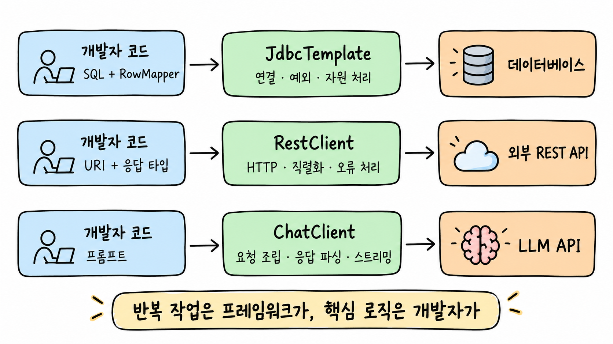
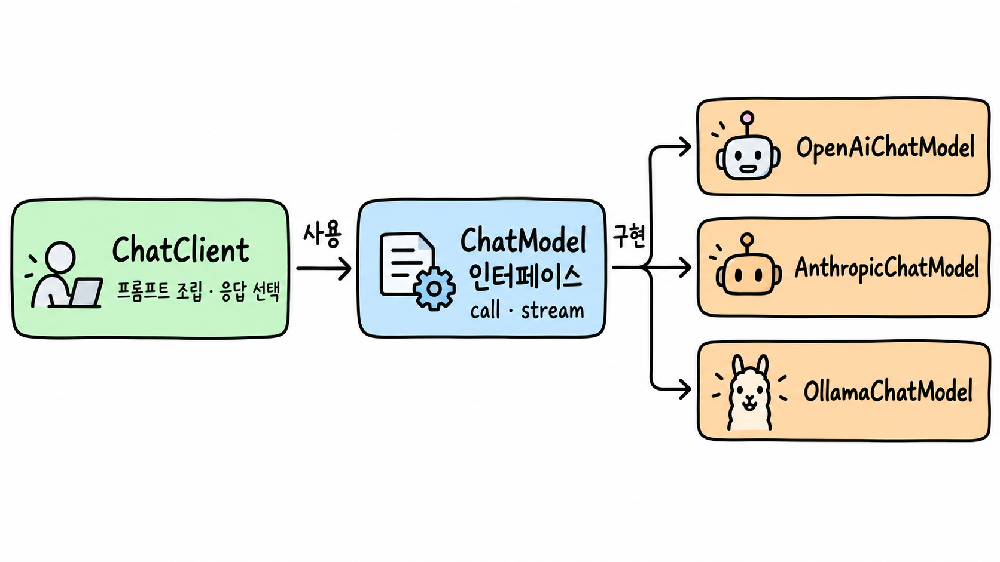
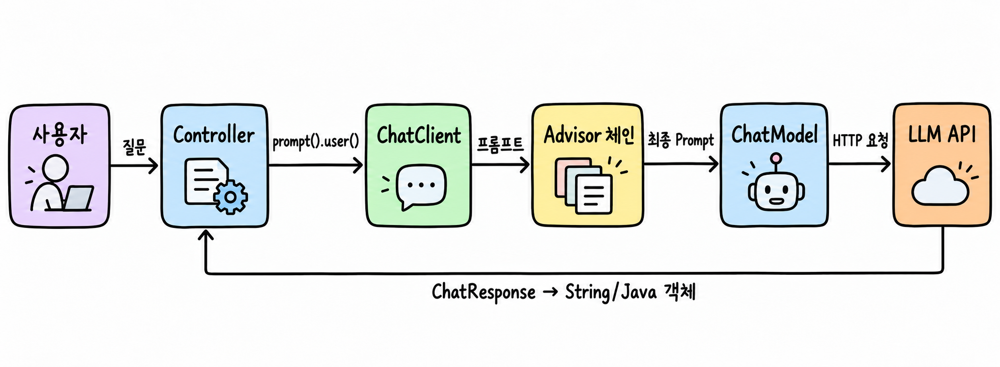
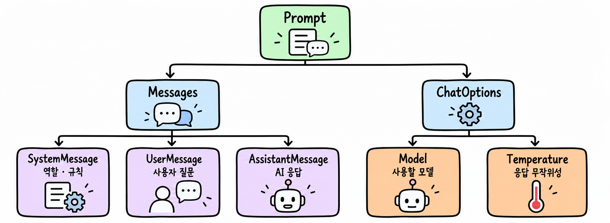
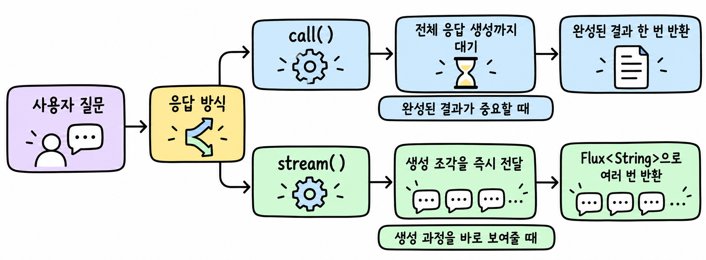

# 채팅 클라이언트 API

> 대상: Spring MVC와 의존성 주입은 알지만 Spring AI는 처음인 컴퓨터공학과 3학년
>
> 기준 문서: [Spring AI 2.0.2 Chat Client API](https://docs.spring.io/spring-ai/reference/api/chatclient.html)

## ChatClient

Spring 개발자는 데이터베이스를 사용할 때 JDBC 연결과 자원 정리를 매번 직접 구현하지 않고 `JdbcTemplate`을 사용한다. 외부 HTTP API를 호출할 때도 요청 생성과 응답 변환을 모두 직접 처리하기보다 `RestClient`를 사용한다.

`ChatClient`도 같은 철학에서 출발한다. 개발자는 프롬프트와 원하는 응답 형태에 집중하고, LLM 요청 조립·응답 파싱·스트리밍 같은 반복 작업은 Spring AI에 맡긴다.



위 그림의 공통점은 **반복 작업은 프레임워크가 맡고, 핵심 로직은 개발자가 작성한다**는 것이다. `ChatClient`를 배우는 것은 새로운 AI 모델을 만드는 일이 아니라, Spring 애플리케이션에서 LLM API를 일관된 방식으로 사용하는 법을 배우는 일이다.

`ChatClient`는 Spring AI가 제공하는 LLM 호출용 고수준 클라이언트다. `JdbcTemplate`, `RestClient`와 비슷한 방식으로 읽을 수 있으며, 모델 제공자가 바뀌더라도 호출 코드의 큰 구조를 유지할 수 있다.

---

## 1. `ChatClient`가 어디에 있는지 파악하기

### 핵심 정의

`ChatClient`는 AI 모델과 대화하기 위한 **개발자용 고수준 API**다. 어떤 모델을 쓰는지는 `ChatModel`에 맡기고, 개발자는 메시지 구성과 결과 처리에 집중한다.



여기서 중요한 점은 `ChatClient`와 OpenAI가 직접 묶여 있지 않다는 것이다. `ChatModel` 구현체를 바꾸면 호출 코드의 큰 틀을 유지하면서 다른 AI 제공자로 교체할 수 있다.

### 한 요청이 처리되는 흐름



---

## 2. 가장 단순한 질문 보내기

Spring Boot 자동 설정은 `ChatClient.Builder`를 Bean으로 준비한다. 생성자에서 Builder를 주입받아 `ChatClient`를 한 번 만들고 재사용하면 된다.

공식 문서의 가장 작은 예제는 다음과 같다.

```java
@RestController
class MyController {

    private final ChatClient chatClient;

    public MyController(ChatClient.Builder chatClientBuilder) {
        this.chatClient = chatClientBuilder.build();
    }

    @GetMapping("/ai")
    String generation(String userInput) {
        return this.chatClient.prompt()
            .user(userInput)
            .call()
            .content();
    }
}
```

### 체인을 한 단계씩 읽기

```text
prompt()        새 AI 요청을 만들기 시작한다.
user(...)       사용자의 질문을 UserMessage로 넣는다.
call()          동기 방식으로 응답을 받을 것이라고 지정한다.
content()       모델을 실제 호출하고 답변 본문을 String으로 꺼낸다.
```

주의할 점이 하나 있다. `call()`만 호출했을 때 모델 요청이 바로 실행되는 것이 아니라, `content()`나 `chatResponse()` 같은 최종 결과 메서드를 호출할 때 실제 요청이 실행된다.

---

## 3. Prompt와 Message 이해하기

### `Prompt`

`Prompt`는 모델에게 보낼 입력 묶음이다. 내부에는 여러 `Message`와 모델 옵션이 들어간다.

### `SystemMessage`

AI의 역할과 답변 규칙을 정하는 메시지다. 예를 들어 “너는 Java 튜터이고, 답변은 한국어로 한다”처럼 대화 전체의 방향을 잡는다.

### `UserMessage`

사용자가 실제로 입력한 질문이다. Controller의 요청 파라미터나 JSON 본문에서 받은 값이 여기에 들어가는 경우가 많다.



`temperature`가 높을수록 표현이 다양해질 수 있고, 낮을수록 답이 더 일관되는 경향이 있다. 다만 지원 범위와 의미는 모델마다 다르므로 모델 문서를 함께 확인해야 한다.

---

## 4. 필요한 응답 형태 고르기

AI 응답을 항상 문자열로만 받을 필요는 없다. 화면에 바로 출력할지, 토큰 사용량을 확인할지, 서비스 로직에서 Java 객체로 사용할지에 따라 반환 형태를 고른다.

| 원하는 결과 | 마지막 메서드 | 언제 사용하는가 |
|---|---|---|
| 답변 문자열 | `content()` | 채팅 화면에 답변만 표시할 때 |
| 답변과 메타데이터 | `chatResponse()` | 토큰 사용량, 생성 결과 정보가 필요할 때 |
| Advisor 실행 정보 포함 | `chatClientResponse()` | RAG가 찾은 문서 등 실행 문맥이 필요할 때 |
| Java 객체 | `entity(Class<T>)` | AI 결과를 서비스 코드에서 구조적으로 사용할 때 |
| 객체와 원본 응답 | `responseEntity(...)` | 변환 결과와 토큰 정보가 모두 필요할 때 |

### 메타데이터까지 받기

```java
ChatResponse chatResponse = chatClient.prompt()
    .user("Tell me a joke")
    .call()
    .chatResponse();
```

### Java 객체로 바로 받기

```java
record ActorFilms(String actor, List<String> movies) {}

ActorFilms actorFilms = chatClient.prompt()
    .user("Generate the filmography for a random actor.")
    .call()
    .entity(ActorFilms.class);
```

`entity()`는 모델의 텍스트 응답을 지정한 Java 타입으로 변환한다. 따라서 “JSON 문자열을 받고 다시 `ObjectMapper`로 변환하는 코드”를 직접 반복하지 않아도 된다.

실서비스에서는 모델이 언제나 완벽한 형식을 반환한다고 가정하면 안 된다. Spring AI 2.0의 `validateSchema()`와 `useProviderStructuredOutput()`을 사용하면 스키마 검증과 제공자 수준의 구조화 출력을 선택할 수 있다.

---

## 5. 반복되는 프롬프트를 템플릿과 기본값으로 정리하기

### 프롬프트 템플릿

문장 구조는 같고 일부 값만 바뀐다면 문자열 더하기 대신 템플릿을 사용한다. `{composer}` 자리에 실행 시점의 값이 들어간다.

```java
String answer = ChatClient.create(chatModel).prompt()
    .user(u -> u
        .text("Tell me the names of 5 movies whose soundtrack was composed by {composer}")
        .param("composer", "John Williams"))
    .call()
    .content();
```

JSON 예시처럼 중괄호가 많은 프롬프트에서는 템플릿 문법과 충돌할 수 있다. 이때는 `StTemplateRenderer`의 구분자를 `<composer>` 같은 형태로 바꿀 수 있다.

### 기본 System 메시지

모든 요청에 같은 역할을 반복해서 적는 대신 Builder에 기본값을 둔다. 기본값은 공통 정책이고, 각 요청의 `system()`, `user()`, `options()` 등으로 필요할 때 덮어쓸 수 있다.

```java
@Configuration
class ChatConfig {

    @Bean
    ChatClient chatClient(ChatClient.Builder builder) {
        return builder
            .defaultSystem("You are a Java tutor. Answer in Korean.")
            .build();
    }
}
```

공식 문서는 기본 설정과 요청별 설정이 어떻게 합쳐지는지 다음 그림으로 설명한다.


출처: Spring AI 공식 문서, *Chat Client API — chat client options merging*.

핵심은 간단하다. Builder의 `default...` 설정을 출발점으로 사용하고, 현재 요청에 같은 종류의 설정이 있으면 요청값이 우선한다.

---

## 6. `call()`과 `stream()` 구분하기

### `call()`

모델이 답변을 모두 생성할 때까지 기다렸다가 완성된 결과를 한 번에 받는 방식이다. 일반적인 Spring MVC API처럼 요청 하나에 응답 하나를 반환하므로 구현과 오류 처리가 단순하다.

### `stream()`

모델이 답변을 생성할 때마다 텍스트 조각을 `Flux<String>`으로 전달하는 방식이다. 전체 답변이 끝나기 전부터 화면에 내용을 표시할 수 있어 사용자가 느끼는 대기 시간이 짧아진다.



### 일반 응답과 스트리밍 응답 비교

| 비교 항목 | 일반 방식: `call()` | 스트리밍 방식: `stream()` |
|---|---|---|
| 반환 형태 | `String`, `ChatResponse`, Java 객체 등 | `Flux<String>`, `Flux<ChatResponse>` |
| 클라이언트가 처음 결과를 보는 시점 | 전체 답변 생성 후 | 첫 텍스트 조각 생성 직후 |
| HTTP 응답 | 보통 한 번에 완성된 본문 반환 | 연결을 유지하며 여러 조각 전송 |
| 구현 난이도 | 비교적 단순 | 중간 취소, 연결 종료, 조각 합치기 고려 필요 |
| 오류 처리 | 응답 전 실패를 한 번 처리 | 일부 전송 후 실패하는 상황도 처리해야 함 |
| 적합한 화면 | 요약 API, 분류, 객체 추출, 내부 처리 | 채팅 UI, 긴 글 생성, 실시간 진행 표시 |
| 피하는 편이 좋은 경우 | 답변이 매우 길어 첫 응답이 늦는 경우 | 짧은 JSON 응답, 배치 처리, 완성된 객체가 필요한 경우 |

`call()`은 **완성된 결과가 중요한 작업**에 적합하다. 예를 들어 감정 분류, 키워드 추출, Java 객체 변환, 서버 내부 배치 작업은 중간 텍스트보다 최종 결과가 중요하다.

`stream()`은 **답변이 만들어지는 과정을 바로 보여주는 것이 중요한 작업**에 적합하다. 챗봇, 긴 보고서 작성, 코드 생성처럼 응답 시간이 길 수 있는 화면에서는 사용자가 결과를 즉시 읽기 시작할 수 있다.

### 실습: 일반 응답과 SSE 스트리밍을 함께 제공하기

아래 Controller는 같은 `ChatClient`로 두 가지 API를 제공한다. `/ask`는 완성된 문자열을 한 번에 반환하고, `/stream`은 Server-Sent Events(SSE)로 텍스트 조각을 계속 전달한다.

```java
package spring_for_llm.controller;

import org.springframework.ai.chat.client.ChatClient;
import org.springframework.http.MediaType;
import org.springframework.web.bind.annotation.GetMapping;
import org.springframework.web.bind.annotation.RequestMapping;
import org.springframework.web.bind.annotation.RequestParam;
import org.springframework.web.bind.annotation.RestController;
import reactor.core.publisher.Flux;

@RestController
@RequestMapping("/api/ai")
public class ChatController {

    private final ChatClient chatClient;

    public ChatController(ChatClient.Builder builder) {
        this.chatClient = builder.build();
    }

    @GetMapping("/ask")
    public String ask(@RequestParam String question) {
        return chatClient.prompt()
                .user(question)
                .call()
                .content();
    }

    /**
     * 사용자 질문에 대한 AI 응답을 Server-Sent Events 방식으로 실시간 스트리밍한다.
     *
     * @param question 사용자 질문
     * @return AI 응답을 비동기 스트림으로 전달하는 Flux
     */
    @GetMapping(value = "/stream", produces = MediaType.TEXT_EVENT_STREAM_VALUE)
    public Flux<String> stream(@RequestParam String question) {
        return chatClient.prompt()
                .user(question) // 사용자 프롬프트 설정
                .stream()       // AI 응답을 스트리밍 방식으로 요청
                .content();     // 생성된 텍스트를 Flux<String>으로 반환
    }
}
```

### 코드에서 꼭 봐야 할 부분

```java
produces = MediaType.TEXT_EVENT_STREAM_VALUE
```

이 설정은 응답의 Content-Type을 `text/event-stream`으로 지정한다. 서버가 연결을 바로 닫지 않고 생성되는 데이터를 순서대로 보낼 수 있게 한다.

```java
.stream()
.content()
```

`stream()`은 스트리밍 호출 방식을 선택하고, `content()`는 생성되는 텍스트 조각을 `Flux<String>`으로 꺼낸다. 구독자가 연결을 종료하면 스트림도 취소될 수 있으므로, 실제 서비스에서는 취소와 네트워크 오류도 고려해야 한다.

### 현재 프로젝트에서 스트리밍을 사용할 때

Spring AI 공식 문서 기준으로 스트리밍은 Reactive 스택을 사용한다. 현재 프로젝트가 `spring-boot-starter-webmvc`만 사용한다면 다음 의존성을 추가해 WebFlux의 Reactive HTTP 지원을 함께 준비한다.

```groovy
dependencies {
    implementation 'org.springframework.boot:spring-boot-starter-webflux'
}
```

Spring MVC와 WebFlux 의존성이 함께 있으면 Spring Boot는 기본적으로 MVC 애플리케이션으로 실행할 수 있지만, `WebClient`와 Reactor 기반 스트리밍 기능은 사용할 수 있다. 처음에는 `/ask`로 기본 호출을 확인한 뒤 `/stream`을 연결하는 순서가 디버깅하기 쉽다.

### 호출 예시

일반 응답은 완성된 본문이 한 번에 도착한다.

```bash
curl "http://localhost:8080/api/ai/ask?question=Spring%20AI가%20뭐야?"
```

SSE 스트리밍은 버퍼링을 끄고 도착하는 조각을 바로 확인한다.

```bash
curl -N "http://localhost:8080/api/ai/stream?question=Spring%20AI를%20설명해줘"
```

정리하면, **서버 코드에서 완성된 결과가 필요하면 `call()`**, **사용자 화면에 생성 과정을 바로 보여줘야 하면 `stream()`**을 선택하면 된다.

---

참고: [Spring AI 2.0.2 Chat Client API](https://docs.spring.io/spring-ai/reference/api/chatclient.html)

